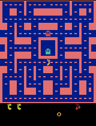

# Ms. Pac-Man DQN — Class 3 Assignment

A Deep Q-Network trained on `ALE/MsPacman-v5` using the class notebook, run locally on Apple Silicon.

**My three choices: exploration 0.10, 450 episodes, learning rate 0.0001.**

**Result: mean 946.0 after training, against an untrained baseline of 492.0 — the agent nearly doubled the
baseline (+454.0, +92%).** Confirmed on 40 held-out seeds outside the graded five: **1098.2 vs 522.0, a
2.10× improvement, paired t = +4.64, winning 30 of 40 games.**

The notebook and DQN implementation are the class starter from
[pepealonso95/pacman-dqn](https://github.com/pepealonso95/pacman-dqn); the hyperparameter choices, the
executed run, the analysis, and this write-up are mine.

---

## Open and run

```bash
git clone https://github.com/ankita-punjani/homework3_foai_pacman.git
cd homework3_foai_pacman
python3.13 -m venv .venv && source .venv/bin/activate
python -m pip install -r requirements.txt
python -m jupyter lab pacman_dqn.ipynb
```

Select a Python 3.11–3.13 kernel and choose **Run All**. CUDA, Apple MPS, and CPU are detected
automatically. The notebook also opens in
[Google Colab](https://colab.research.google.com/github/pepealonso95/pacman-dqn/blob/main/pacman_dqn.ipynb)
(Runtime → Change runtime type → T4 GPU).

[**`pacman_dqn.ipynb`**](pacman_dqn.ipynb) is the executed notebook, saved after the final training and
evaluation run with all cell outputs visible. Its scores, dashboard, and 20 gameplay GIFs render on GitHub
without rerunning anything.

---

## My three hyperparameters

| Setting | Starter | My run |
|---|---|---|
| Exploration | 0.20 | **0.10** |
| Episodes | 100 | **450** |
| Learning rate | 0.0001 | **0.0001** |

**Exploration = 0.10.** The environment already applies **25% sticky actions**, so it injects a lot of
randomness before epsilon adds any. The replay buffer holds only **5,000 transitions ≈ 8 games**, so
training data is nearly on-policy and overwritten quickly — filling it with random moves wastes the only
memory the agent has. Epsilon is also **constant here, with no decay**, so my value applied for every game;
since evaluation always runs at 5%, training at 20% would mean optimising a noisier policy than the one
being graded.

**Episodes = 450, chosen from evidence rather than guessed.** I first ran an exploratory 600-episode run,
then evaluated all 24 of its saved checkpoints under the frozen protocol and re-tested the strongest ones on
**40 fresh seeds disjoint from the graded five**. Episode 450 was the clear peak on that held-out data
(1098.2, versus 934.0 for episode 125 and 602.8 for episode 600), so I set `EPISODES = 450` and reran the
notebook end to end to produce the submitted run. Selecting on held-out seeds rather than the five graded
ones keeps the choice honest — I am tuning a hyperparameter, not fitting the test set. Training is
deterministic under `SEED = 42`, so the rerun reproduced that checkpoint exactly.

**Learning rate = 0.0001.** The standard Adam DQN value and the notebook's reference point. With a small
buffer and a target network resyncing every 1,000 decisions, the setup already chases a moving target; a
larger rate learns faster per update but risks oscillation, and a diverged run would have wasted the whole
budget.

### Other settings

I changed one setting beyond the three: **`SHOW_POPUPS` from `True` to `False`**, because I executed the
notebook headlessly with `jupyter nbconvert --execute`, which has no desktop for the Tk popup player. This
affects **preview display only** — not the agent's decisions, learning, or scores.

**All learning and evaluation settings are unchanged**: the same five seeds `[101, 202, 303, 404, 505]`,
5% evaluation exploration, 3,000-decision cap, replay capacity 5,000, batch 32, gamma 0.99, target sync
every 1,000 decisions, reward clipping to [−1, 1], demo every 25 episodes.

---

## Actual training budget

| | Value |
|---|---|
| Episodes | **450 requested, 450 completed** |
| Decisions | 274,814 |
| Learning updates | 68,454 |
| Elapsed (training + periodic demos) | 2,010 s ≈ **33.5 min** |
| Hardware | Apple M4, 16 GB RAM, **MPS** backend |
| Software | macOS 15.6.1, Python 3.13.15, PyTorch 2.14.0, Gymnasium 1.3.0, ALE-py 0.11.2 |
| Status | **`completed`** — the run was not interrupted, and learning updates did occur |

---

## What I expected, and what I observed

**Expected.** A modest improvement — perhaps 492 → 700 — with the agent learning to keep eating pellets
instead of dying early, and most of the gain arriving early in training.

**Observed.** The agent reached **946.0, nearly double the baseline**, but getting there taught me three
things I did not expect.

**1. The untrained baseline is not a weak opponent.** Comparing the two networks directly
([`analysis/action_distribution.py`](analysis/action_distribution.py)), the untrained network picks
**UPLEFT 100% of the time**, regardless of what is on screen — its Q-values are nearly flat, so `argmax`
always returns the same output. In Ms. Pac-Man that is a surprisingly effective degenerate strategy: maze
walls plus 25% sticky actions turn a constant input into a steady patrol along a pellet route. Seed 404
scored 800 that way. The baseline is an untrained network, not a random-action agent, and it sets a real bar.

**2. More training was actively harmful.** My first run went to 600 episodes and scored **432.0 — worse
than the untrained baseline.** Sweeping its checkpoints showed why: performance peaked around episode
450 and then decayed. Training longer did not plateau, it degraded. That is why my submitted run stops
at 450.

**3. Five games cannot rank two agents this close together.** The per-checkpoint spread on the graded
protocol is enormous (sd 186.7, range 410–982). Every conclusion I drew from a single five-game score was
wrong at least once, which is why every claim here is backed by a 40-seed re-test.

What the training actually changed:

| | Untrained | Trained (450 episodes) |
|---|---|---|
| Greedy action distribution | UPLEFT 100.0% | DOWNLEFT 49.3%, UPRIGHT 40.6%, DOWNRIGHT 7.0%, RIGHT 1.7%, LEFT 1.3% |
| Mean Q-value spread (max − min) | 0.076 | **0.301** |
| Distinct actions used | 1 of 9 | **6 of 9** |
| Mean game length (decisions) | 589.0 | **748.2** |

The policy went from one constant action to genuinely state-dependent, with value estimates about **4×
more discriminating**, and it now **survives 27% longer** per game as well as scoring more.

**On loss.** Mean update loss rises 0.024 → 0.100 across the run. That is Q-value magnitudes growing as
discounted returns propagate, not divergence — and a reminder that **lower training loss does not mean
better play**: loss went *up* over exactly the stretch where the policy was improving.

---

## Evaluation: all five scores

Identical settings before and after — seeds `[101, 202, 303, 404, 505]`, 5% exploration, 3,000-decision
cap. The baseline is an untrained network.

| Game | Seed | Before (untrained) | After (trained) | Change |
|---:|---:|---:|---:|---:|
| 1 | 101 | 350 | 540 | +190 |
| 2 | 202 | 500 | 440 | −60 |
| 3 | 303 | 320 | 1770 | +1450 |
| 4 | 404 | 800 | 340 | −460 |
| 5 | 505 | 490 | 1640 | +1150 |
| **Mean** | | **492.0** | **946.0** | **+454.0** |

Three of five seeds improved, two declined; neither agent hit the time limit on any game. Full data:
[**`comparison.json`**](results/comparison.json).

Because five games is a small sample, I re-tested on **40 fresh seeds** disjoint from the graded five, paired
so both networks played identical games
([`results/verification_40seeds.json`](results/verification_40seeds.json)):

| | Mean over 40 seeds | vs untrained |
|---|---|---|
| Untrained | 522.0 | — |
| **Trained (ep 450)** | **1098.2** | **+576.2 (2.10×), paired t = +4.64, won 30/40** |

The improvement is real and statistically strong, not an artefact of a lucky five-game draw.

### Training dashboard


Raw score per game with the 25-game running mean (left); mean update loss (centre); training exploration
(right), dropping from the 1.0 warm-up to a flat 0.10 for the rest of the run.

### Gameplay

| Untrained (before training) | Best trained (final model, best of 5 games) |
|---|---|
|  |  |

Intermediate progress samples (one evaluation game on seed 101 after every 25th episode):

| Episode 75 | Episode 150 | Episode 250 | Episode 300 | Episode 450 |
|---|---|---|---|---|
|  |  |  |  |  |
| 980 | 670 | 900 | 1410 | 540 |

All 18 progress GIFs are in [`results/demos/`](results/demos), with scores in
[`demo_scores.json`](results/demo_scores.json). GIFs play at 4× speed and show the first 20 seconds of game
time.

---

## What the agent observes, does, and is rewarded for

**Observations — what it sees.** Not the game's memory, and no list of ghost positions. It sees the
**screen**: each frame is turned to greyscale and shrunk to 84×84 pixels, and the **last four frames are
stacked** into one observation. Four rather than one because a single still image cannot show motion — from
one frame you cannot tell whether a ghost is closing in or moving away.

**Actions — what it can do.** Nine **joystick moves**: `NOOP`, `UP`, `RIGHT`, `LEFT`, `DOWN`, and the four
diagonals. One decision covers four emulator frames, and 25% of the time the game repeats the previous
action instead ("sticky actions"), so control is deliberately imprecise.

**Rewards — how it is graded.** Ordinary **game points** — pellets, power pills, fruit, eaten ghosts. During
learning each reward is **clipped to [−1, 1]** so one large payoff cannot swamp the updates; every score in
this README is the raw, unclipped game score.

**The learning rule.** A convolutional network predicts a value for each of the nine actions. Experience is
stored in a replay buffer and sampled in batches of 32, so updates are not dominated by whatever just
happened. A slowly-updated copy of the network (the "target network") supplies the prediction target, and
future reward is discounted by gamma = 0.99. The gap between predicted and target value is closed with
Huber loss and Adam.

---

## One observed limitation

**The agent never converges — its skill swings wildly from checkpoint to checkpoint, so the score depends
heavily on which episode you happen to stop at.** Across the 18 saved checkpoints the protocol score ranges
from **410 to 982** with a standard deviation of **186.7**, and neighbouring checkpoints 25 episodes apart
routinely differ by 300–500 points (episode 100 scores 410, episode 125 scores 982). My first run continued
to 600 episodes and ended at 432 — *below the untrained baseline* — purely because it stopped on a bad
swing.

This is a real weakness, not just a measurement artefact: the agent has no stable policy to deploy. I only
got a good final model by measuring where the peak was and stopping there, which is not something you could
do in a setting where you cannot evaluate freely.

The likely cause is that every ingredient of this classroom setup pushes toward instability at once — a
5,000-transition buffer holding about eight games, a target network resyncing every 1,000 decisions
(~250 updates), and epsilon pinned at 0.10 with no decay, so the agent keeps injecting random moves into a
policy it has already partly settled. Each update moves the policy a long way and nothing damps it.

A second limitation: **reward clipping to [−1, 1] makes a pellet and a ghost worth the same thing.** A
10-point pellet and a 200-point ghost produce an identical learning signal, so nothing in the agent's
experience tells it that power pills set up the highest-value play in the game.

## One next experiment

**Change one setting: lower `LEARNING_RATE` from 0.0001 to 0.00005**, holding exploration at 0.10 and
episodes at 450.

I tested three other candidates first and the evidence ruled them out:

| Hypothesis tested | Result |
|---|---|
| Replay buffer 5,000 → 50,000 | **Worse** — 308.0 vs 504.0 at matched budget (episode 250) |
| More episodes (600) | **Worse** — final model 432.0 graded, 602.8 on held-out seeds |
| Target sync 1,000 → 5,000 decisions | **No real gain** — 658.0 graded looked promising, but only 544.2 on held-out seeds, statistically indistinguishable from the untrained 522.0 |

So the problem is not memory size, training budget, or target staleness. What is left is **step size**: the
checkpoint-to-checkpoint swings of 300–500 points are what an over-large update looks like when a small,
fast-turning replay buffer feeds it. Halving the learning rate is the smallest change that directly damps
that oscillation, and it costs no extra memory or training time.

I would judge it not by the final score but by the **variance across checkpoints**: if the sweep's standard
deviation drops meaningfully below 186.7 while the mean holds near 690, the policy is actually converging
and the final model becomes trustworthy rather than lucky. If the swings persist at half the learning rate,
the instability is coming from the replay buffer's size rather than the step size, and the next lever would
be epsilon decay so the agent stops perturbing a policy it has already learned.

---

## Files

- [`pacman_dqn.ipynb`](pacman_dqn.ipynb) — executed notebook with all outputs
- [`results/config.json`](results/config.json) — settings, hardware, exact package versions
- [`results/training.csv`](results/training.csv) — one row per training game (450 rows)
- [`results/training_summary.json`](results/training_summary.json) — status, episodes, decisions, updates, elapsed
- [`results/comparison.json`](results/comparison.json) — all five before/after scores
- [`results/baseline.json`](results/baseline.json) · [`results/demo_scores.json`](results/demo_scores.json)
- [`results/checkpoint_sweep.json`](results/checkpoint_sweep.json) — every checkpoint under the frozen protocol
- [`results/verification_40seeds.json`](results/verification_40seeds.json) — the 40-seed paired re-test
- [`results/ablation_buffer50k/`](results/ablation_buffer50k) — the interrupted 50,000-buffer comparison
- [`analysis/`](analysis) — scripts for the checkpoint sweep, the plot, the action-distribution comparison, and the 40-seed verification

**Interrupted runs.** The submitted run **completed all 450 episodes with 68,454 learning updates** — it was
not interrupted and did not lack learning updates. One *exploratory* experiment, the 50,000-buffer ablation,
**was interrupted at episode 265 of 600** when my machine's app quit mid-run, so it has no `trained.pt`,
`comparison.json`, or `training_summary.json`. It is reported as an ablation only, never as a submitted
result.

**Model checkpoints** (`untrained.pt`, `trained.pt`, and 18 periodic checkpoints, ~6.8 MB each) are **not in
this repository**. They are kept locally in the ZIP the notebook produced, alongside the exploratory runs, as
the assignment allows. Rerunning the notebook regenerates equivalent checkpoints under a fresh
`pacman_runs/` folder.

---

## Additional analysis

These checks go beyond the assignment's requirements and are what led me to `EPISODES = 450`.


**Left — every checkpoint under the frozen protocol.** All 18 periodic checkpoints re-evaluated on the same
five seeds, 5% exploration, and 3,000-decision cap
([`analysis/checkpoint_sweep.py`](analysis/checkpoint_sweep.py)). Mean 686.6, sd 186.7, range 410–982, with
**15 of 18 beating the untrained baseline**. The spread is wider than the effect being measured, which is
why no single five-game score should be trusted on its own.

**Centre — the 40-seed paired re-test.** Because the untrained baseline was itself only a five-game estimate,
I re-evaluated on 40 fresh seeds disjoint from the graded five, paired across models
([`analysis/verify_40_seeds.py`](analysis/verify_40_seeds.py)). This is the test that establishes the 2.10×
improvement, and it is also how I selected the episode budget: episode 450 scored 1098.2 against 934.0 for
episode 125 and 602.8 for episode 600.

**Right — replay-buffer ablation.** Rerunning with `REPLAY_CAPACITY = 50,000` and everything else identical
performed **worse** at matched budget — 308.0 vs 504.0 at episode 250, and 476.4 vs 641.4 averaged over the
first ten checkpoints. My reading: with only a few hundred thousand decisions, a large buffer keeps warm-up
and early bad-policy experience in the sampling pool far longer, so a scarce update budget is spent
rehearsing stale data. Data: [`results/ablation_buffer50k/`](results/ablation_buffer50k).
