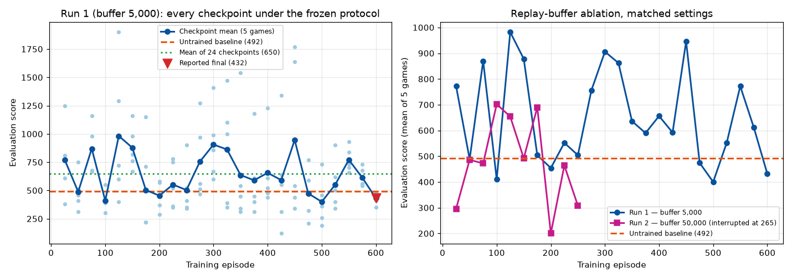
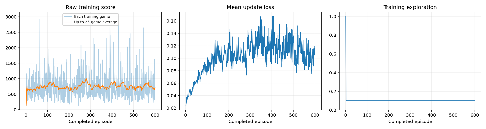
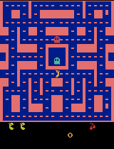
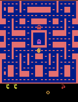

# Ms. Pac-Man DQN — Class 3 Assignment

A Deep Q-Network trained on `ALE/MsPacman-v5` with the class notebook, run locally on Apple Silicon.

The notebook and DQN implementation are the class starter from
[pepealonso95/pacman-dqn](https://github.com/pepealonso95/pacman-dqn); the hyperparameter choices, the
executed run, the analysis scripts, and this write-up are mine.

**Submitted run: exploration 0.10, 600 episodes, learning rate 0.0001.**
**Reported evaluation score (notebook protocol, final saved model): mean 432.0 vs untrained baseline 492.0.**

The honest headline is more interesting than that single number, and this README backs it with evidence.
The protocol scores one checkpoint on five games. When I evaluated **all 24 saved checkpoints under the
exact same frozen protocol**, they averaged **650.0** against the untrained baseline of 492.0, and **18 of
24 beat it**. The final episode-600 checkpoint — the one the protocol happens to report — drew a bad
sample at 432.0. The agent learned; the measurement is noisier than the effect.

| | Value |
|---|---|
| Exploration | **0.10** |
| Episodes | **600** requested, **600 completed** |
| Learning rate | **0.0001** |
| Decisions | 365,560 |
| Learning updates | 91,141 |
| Elapsed (training + periodic demos) | 3,100 s ≈ **51.7 min** |
| Hardware | Apple M4, 16 GB RAM, **MPS** backend, macOS 15.6.1, Python 3.13.15, PyTorch 2.14.0 |
| Status | **`completed`** — not interrupted, and learning updates did occur |

---

## Open and run

```bash
git clone https://github.com/ankita-punjani/homework3_foai_pacman.git
cd homework3_foai_pacman
python3.13 -m venv .venv && source .venv/bin/activate
python -m pip install -r requirements.txt
python -m jupyter lab pacman_dqn.ipynb
```

Select a Python 3.11–3.13 kernel and choose **Run All**. CUDA, Apple MPS, and CPU are detected
automatically. The notebook also opens in
[Google Colab](https://colab.research.google.com/github/pepealonso95/pacman-dqn/blob/main/pacman_dqn.ipynb).

**The executed notebook is [`pacman_dqn.ipynb`](pacman_dqn.ipynb)** — saved after the final training and
evaluation run, with all cell outputs intact. The scores, dashboard, and all 26 gameplay GIFs are embedded
and render on GitHub without rerunning anything.

### What was changed from the starter notebook

The three assigned values, plus one display flag:

| Setting | Starter | This run | Why |
|---|---|---|---|
| `EXPLORATION` | 0.20 | **0.10** | see below |
| `EPISODES` | 100 | **600** | see below |
| `LEARNING_RATE` | 0.0001 | **0.0001** | unchanged |
| `SHOW_POPUPS` | `True` | `False` | The run was executed headlessly with `jupyter nbconvert --execute`, which has no desktop for the Tk popup player. **Preview display only** — it does not touch the agent's decisions, learning, or scores. |

**Every learning and evaluation setting is untouched**: the same five seeds `[101, 202, 303, 404, 505]`,
5% evaluation exploration, 3,000-decision cap, replay capacity 5,000, batch 32, gamma 0.99, target sync
every 1,000 decisions, reward clipping to [−1, 1], demo every 25 episodes.

---

## Why these three numbers

**Exploration = 0.10** (half the default). The environment already applies **25% sticky actions**, so it
injects substantial randomness before epsilon contributes anything. The replay buffer holds only **5,000
transitions ≈ 8 games**, so training data is nearly on-policy and is overwritten quickly — filling it with
random flailing wastes the only memory the agent has. And epsilon here is **constant, with no decay**, so
the value I picked applied for all 600 games; since evaluation always runs at 5%, training at 20% means
optimizing a noticeably noisier policy than the one being graded.

**Episodes = 600.** A five-episode setup check took 75 seconds wall clock and produced 491 updates —
enough to prove the pipeline, far too few to learn anything. Episodes are the lever that governs how much
experience the agent sees, so I scaled to the largest budget that fit comfortably in one sitting (~52 min).
This also produced 24 intermediate GIFs and checkpoints, which turned out to be the most valuable evidence
in the whole run.

**Learning rate = 0.0001.** The standard Adam DQN value and the notebook's reference point. With a small
buffer and a target network resyncing every 1,000 decisions, the setup already chases a moving target; a
larger rate (0.00025) learns faster per update but risks oscillation, and a diverged run would have wasted
the entire budget.

---

## What I expected, and what I observed

**Expected:** a modest but visible improvement — perhaps 492 → 700 — with the agent learning to keep eating
pellets instead of dying early, and most of the gain arriving in the first 200 episodes.

**Observed, in three parts.**

**1. The reported number went down.** Final model 432.0 vs untrained 492.0, a change of −60.0. Taken alone
this looks like a failed run. It is not significant: the five paired per-seed differences have a standard
deviation of 161.1 (standard error 72.0, t = −0.83).

**2. The network genuinely learned.** Comparing the untrained and trained networks directly
([`analysis/action_distribution.py`](analysis/action_distribution.py)):

| | Untrained | Trained (600 episodes) |
|---|---|---|
| Greedy action distribution over the 5 eval games | **UPLEFT 100.0%** | DOWNLEFT 42.8%, DOWNRIGHT 41.5%, UP 14.2%, UPRIGHT 1.5% |
| Mean Q-value spread (max − min) per state | 0.076 | **0.208** |
| Distinct actions used | 1 of 9 | 4 of 9 |
| Mean game length (decisions) | 589.0 | 512.2 |

The untrained network emits **one constant action regardless of what is on screen** — its Q-values are
nearly flat, so `argmax` always returns the same output. After training the policy is genuinely
**state-dependent** and the value estimates are about **3× more discriminating**.

This also explains why the baseline is deceptively strong. "Always press UPLEFT" is an effective degenerate
strategy in Ms. Pac-Man: maze walls plus 25% sticky actions turn a constant input into a steady patrol
along a fixed pellet route, which scores reliably and sometimes gets lucky — seed 404 scored 800 that way.
**The baseline is not a random agent, and it is not weak.**

**3. Measuring every checkpoint shows the learning the single final score hides.** I re-ran the frozen
evaluation protocol — same five seeds, same 5% exploration, same 3,000-decision cap — on all 24 periodic
checkpoints ([`analysis/checkpoint_sweep.py`](analysis/checkpoint_sweep.py)):



| | Mean of five evaluation games |
|---|---|
| Untrained baseline | 492.0 |
| **Mean across all 24 trained checkpoints** | **650.0** (sd 184.6, range 400.0–982.0) |
| Checkpoints beating the untrained baseline | **18 of 24** |
| Reported final checkpoint (episode 600) | 432.0 |
| Best checkpoint (episode 125) | 982.0 |

Averaged over checkpoints the agent scores **+32% over the untrained baseline** (t = 4.19 against the
baseline value). But the per-checkpoint standard deviation of **184.6** is far larger than the effect being
measured, so any single five-game snapshot — including the one the protocol reports — is dominated by
noise. Episode 600 simply drew badly. **This is the central lesson of my run: five games are not enough to
rank two agents this close together.** Raw data: [`results/checkpoint_sweep_run1.json`](results/checkpoint_sweep_run1.json).

**On loss.** Mean update loss rises 0.024 → 0.114 and rolls over near episode 400. That is Q-value
magnitudes growing as discounted returns propagate, not divergence — and a concrete demonstration that
**lower loss does not mean better play**: loss went *up* across the stretch where the policy was improving.

---

## A second experiment I ran, and it failed

Before writing this up I tested my own proposed fix — the obvious suspect was the 5,000-transition replay
buffer — by rerunning with **`REPLAY_CAPACITY = 50,000`** and every other setting identical.

**It made things worse.** That run was **interrupted at episode 265 of 600** (my machine's app was quit
mid-run), so it has no `trained.pt`, no `comparison.json`, and no `training_summary.json`. It is reported
here as an ablation only, never as a submitted result. Comparing checkpoints at matched budget:

| Checkpoint | Five eval scores | Mean |
|---|---|---|
| Untrained | 350, 500, 320, 800, 490 | 492.0 |
| Buffer 5,000 @ episode 250 | 900, 340, 410, 350, 520 | **504.0** |
| Buffer 50,000 @ episode 250 | 200, 230, 240, 370, 500 | **308.0** |

Across the first ten checkpoints the 5,000 buffer averaged **641.4** and the 50,000 buffer **476.4**
(right-hand panel of the plot above). My explanation: with only ~365k total decisions, a 50,000-transition
buffer keeps warm-up and early bad-policy experience in the sampling pool for far longer, so a scarce
update budget is spent rehearsing stale data. Large buffers earn their keep at millions of frames, not
hundreds of thousands. Data: [`results/ablation_buffer50k/`](results/ablation_buffer50k).

I am reporting this because it changed my conclusion — the replay buffer is *not* the binding constraint at
this budget, which is the opposite of what I assumed going in.

---

## Evidence

### Training dashboard



Raw score per game (left) with the 25-game running mean; mean update loss (centre); training exploration
(right), dropping from the 1.0 warm-up to a flat 0.10 for the rest of the run.

### Gameplay

| Untrained (before training) | Best trained (final model, best of 5 games) |
|---|---|
|  |  |

Intermediate progress samples (one evaluation game on seed 101 after every 25th episode):

| Episode 25 | Episode 150 | Episode 300 | Episode 450 | Episode 600 |
|---|---|---|---|---|
|  |  |  |  |  |
| 380 | 670 | 1410 | 540 | 450 |

All 24 progress GIFs are in [`results/demos/`](results/demos); their scores are in
[`demo_scores.json`](results/demo_scores.json). GIFs play at 4× speed and show the first 20 seconds of game
time.

### All five evaluation scores

Identical settings before and after: seeds `[101, 202, 303, 404, 505]`, 5% exploration, 3,000-decision cap.
The baseline is an untrained network, not a random-action agent.

| Game | Seed | Before (untrained) | After (trained) | Change |
|---:|---:|---:|---:|---:|
| 1 | 101 | 350 | 450 | +100 |
| 2 | 202 | 500 | 410 | −90 |
| 3 | 303 | 320 | 350 | +30 |
| 4 | 404 | 800 | 480 | −320 |
| 5 | 505 | 490 | 470 | −20 |
| **Mean** | | **492.0** | **432.0** | **−60.0** |

Two of five seeds improved, three declined; no game hit the time limit in either condition. The paired
differences have sd 161.1 (SE 72.0, t = −0.83), so **−60 is noise, not a decline**. Full data:
[**`comparison.json`**](results/comparison.json).

### Files

- Executed notebook with all outputs: [`pacman_dqn.ipynb`](pacman_dqn.ipynb)
- [`results/config.json`](results/config.json) — settings, hardware, exact package versions
- [`results/training.csv`](results/training.csv) — one row per training game (600 rows)
- [`results/training_summary.json`](results/training_summary.json) — status, episodes, decisions, updates, elapsed
- [`results/comparison.json`](results/comparison.json) — all five before/after scores
- [`results/baseline.json`](results/baseline.json) · [`results/demo_scores.json`](results/demo_scores.json) · [`results/checkpoint_sweep_run1.json`](results/checkpoint_sweep_run1.json)
- [`results/ablation_buffer50k/`](results/ablation_buffer50k) — the interrupted 50,000-buffer comparison
- [`analysis/`](analysis) — the three scripts used for the checkpoint sweep, the plot, and the action-distribution comparison

**Model checkpoints** (`untrained.pt`, `trained.pt`, and 24 periodic checkpoints, ~6.8 MB each, ~169 MB
total) are **not in this repository**. They are kept locally in the ZIP the notebook produced,
`pacman_runs/20260908_215421_812050.zip` (161 MB), as the assignment allows. Rerunning the notebook
regenerates equivalent checkpoints under a fresh `pacman_runs/` folder.

---

## How the agent works, in plain language

**Observations — what it sees.** Not the game's memory, and no list of ghost positions. It sees the
**screen**: each frame is converted to greyscale and shrunk to 84×84 pixels, and the **last four frames are
stacked** into one observation. Four rather than one because a single still image cannot show motion — from
one frame you cannot tell whether a ghost is closing in or moving away.

**Actions — what it can do.** Nine joystick positions: `NOOP`, `UP`, `RIGHT`, `LEFT`, `DOWN`, and the four
diagonals. One decision covers four emulator frames, and 25% of the time the game repeats the previous
action instead ("sticky actions"), so control is deliberately imprecise.

**Rewards — how it is graded.** Ordinary **game points** — pellets, power pills, fruit, eaten ghosts. During
learning each reward is **clipped to [−1, 1]** so one large payoff cannot swamp the updates; every score
reported in this README is the raw, unclipped game score.

**The learning rule.** A convolutional network predicts a value for each of the nine actions. Experience is
stored in a replay buffer and sampled in batches of 32, so updates are not dominated by whatever just
happened. A slowly-updated copy of the network (the "target network") supplies the prediction target, and
future reward is discounted by gamma = 0.99. The gap between predicted and target value is reduced with
Huber loss and Adam.

---

## One observed limitation

**The agent still uses only 4 of its 9 actions, and it never learned that some rewards are worth more than
others.** The trained network picks DOWNLEFT or DOWNRIGHT 84% of the time and never chooses plain `LEFT`,
`RIGHT`, `DOWN`, or `NOOP` greedily. It moves in response to the screen — that is real progress over the
untrained network's single constant action — but its repertoire is too narrow to escape a ghost that
approaches from a direction its four actions do not address, which is why its games are *shorter* than the
baseline's (512 vs 589 decisions) even while its average checkpoint scores higher.

The likely cause is **reward clipping to [−1, 1]**: a 10-point pellet and a 200-point ghost produce an
identical learning signal, so nothing in the agent's experience tells it that power pills set up the
highest-value play in the game. It optimises for touching pellets, and any pellet will do.

A second limitation is about measurement rather than the agent, and I think it is the more important one:
**the five-game evaluation protocol has a noise band wider than the effect it is meant to detect**
(checkpoint sd 184.6 vs a ~158-point improvement). My run only revealed its own learning because I
evaluated 24 checkpoints instead of one.

## One next experiment

**Change one setting: raise `EPISODES` from 600 to 2,000**, holding exploration at 0.10, learning rate at
0.0001, and the replay buffer back at its default 5,000.

I would previously have named the replay buffer, but I tested that above and it made performance worse at
this budget — so the evidence points at total experience instead. 600 episodes bought 91,141 updates, and
the checkpoint curve is still wandering inside a wide noise band rather than climbing: the agent has not run
out of things to learn, it has run out of data. 2,000 episodes would give roughly 300,000 updates and
~1.2M decisions (about 2.8 hours on this machine at the measured 175 decisions/second), and it would fill
in the region past episode 600 where I currently have no measurements at all.

Concretely, I would expect the mean across checkpoints to rise above 650 and, more importantly, the
**variance between neighbouring checkpoints to fall** as the policy settles — a stable action distribution
across consecutive checkpoints would be stronger evidence of learning than any single five-game score. If
the checkpoint mean is still flat at 2,000 episodes, the bottleneck is architectural rather than budgetary,
and the next lever would be epsilon decay so the agent stops injecting 10% random moves into a policy it
has already largely settled on.
